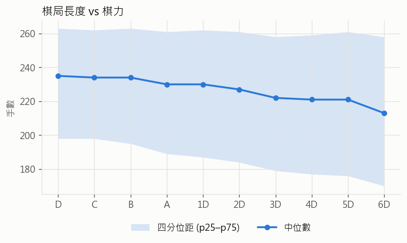
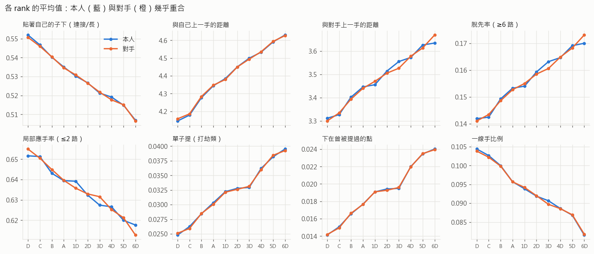
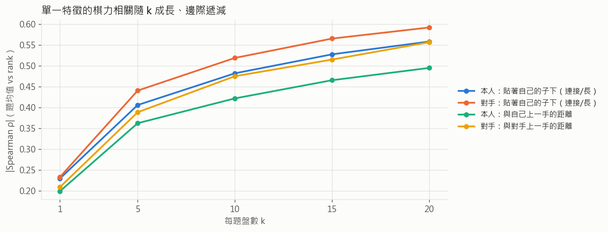
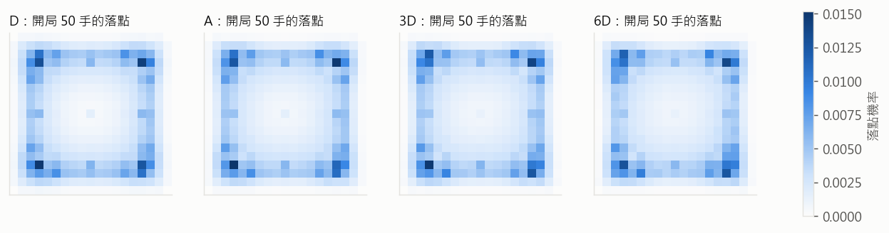
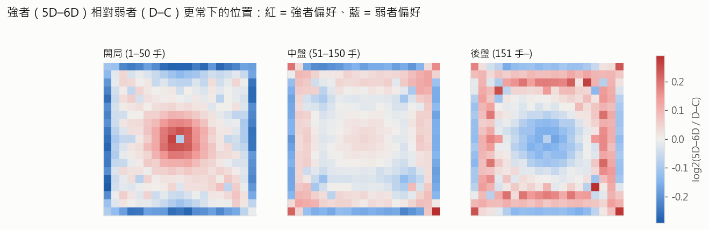
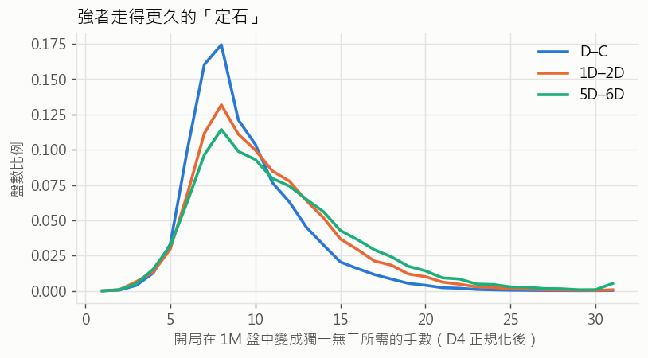
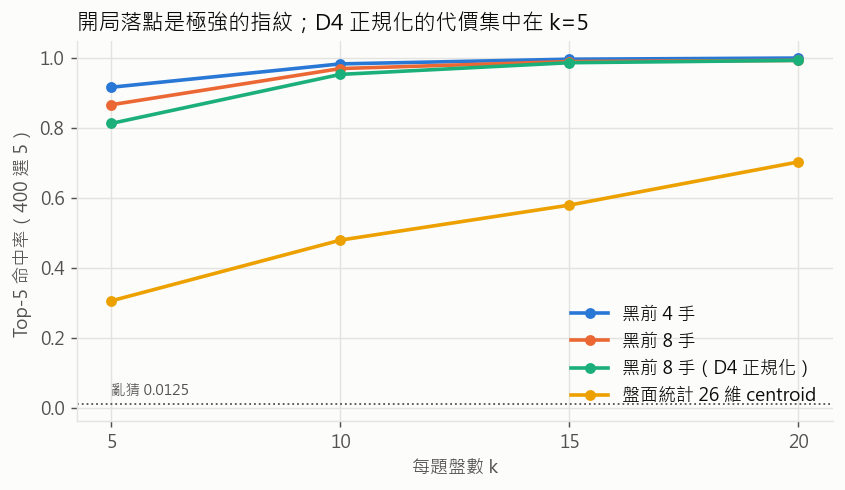

# W1 訊號 EDA — 棋力與玩家指紋在哪裡

產生時間：2026-10-03 10:53　資料：全量訓練集 1,000,000 盤
產生方式：`python -m go_aicup.features.game_stats && python scripts/eda_report.py`（全程 CPU，約 2 分鐘）

> 結構面稽核（欄位、重複、長度、玩家數）見 `01_audit.md` 與 `RESULTS.md` A-001～A-003，本報告不重複。
> 本報告回答的是：**訊號在哪裡、有多強、隨 k 怎麼變、兩賽的需求哪裡衝突。**
> 兩個探針（第 4、8 節）只用來量化訊號，不是提交模型，也不登記為實驗。

## 0. 總結：七個發現與對計畫的影響

| # | 發現（數字見各節） | 對計畫的影響 |
|---|------|------|
| E1 | **單盤手工特徵的棋力訊號很弱**：最強特徵 rank η² 只有 0.057，80–95% 是盤內雜訊（§2） | k 盤聚合是必需品；單盤表徵的品質（L1、L5）才是天花板所在 |
| E2 | **同 rank 內的玩家風格差異 > rank 之間的差異**（本人特徵玩家成分是 rank 成分的 1.5–5 倍）（§2、§3） | 「記住玩家」風險被量化了；k→∞ 也突破不了這個天花板。競賽二的 player-adversarial / 每人一盤取樣是必要的 |
| E3 | **對手的手與本人的手棋力訊號一樣強**，且距離類特徵的玩家成分只有一半（§2、§4、§5）。線性探針：只用對手 acc 0.249 vs 只用本人 0.258，合併 0.276 | **L2 升級為主力設計**：rank 頭同時吃雙方的手。對手的手是更乾淨、較不帶身分的棋力訊號 |
| E4 | 手工特徵 + 線性模型：acc 0.23（k=5）→ 0.31（k=20），QWK 0.69 → 0.83，MAE 1.74 → 1.23（§4） | P0 GBDT 值得做；錯誤呈 ordinal 結構 → 指標若是 MAE/QWK，ordinal head 必做 |
| E5 | **開局落點是極強的玩家指紋**：黑前 4 手逐手 naive Bayes（零訓練）在合成候選庫上 top-1 0.91、top-5 0.97、MAP@5 0.94；k=5 桶 top-5 0.92（§8） | 競賽一的 P0 可以直接用這個計數模型，當天就有強 baseline。名次差距將集中在 k=5 桶與排序品質（top-1 / MAP） |
| E6 | **D4 正規化的代價中等且集中在 k=5**（黑前 8 手 k=5 桶 top-5 0.867 → 0.813，MAP@5 0.910 → 0.863）（§8） | 「競賽一禁用 D4」有數字支持；棋力的空間訊號（線位、中腹 vs 邊）都是 D4 不變的 → 競賽二用 D4 安全（§6） |
| E7 | `game_id` 是打亂的流水號，**沒有時間資訊**；勝負代理（最後一手）與終局子數無棋力訊號（§1） | 「風格隨時間漂移」無法驗證（未知）；若主辦方依時間切候選庫與查詢盤，合成驗證會高估競賽一 |

**需要注意的偏差：** 競賽一的合成候選庫是 ≥120 盤黑棋的重度玩家（習慣可能更固定）；
競賽二的 k=20 題只來自各 rank 的活躍子集（§10）。真實候選庫發布後，第一件事是用 §8.1 的「個人最常用第一手佔比」比對分布。

## 1. 棋局長度、終局方式、執色

|    |   mean |   10% |   25% |   50% |   75% |   90% |
|:---|-------:|------:|------:|------:|------:|------:|
| D  |  227.8 |   156 |   198 |   235 |   263 |   284 |
| C  |  227.3 |   157 |   198 |   234 |   262 |   284 |
| B  |  226.6 |   154 |   195 |   234 |   263 |   285 |
| A  |  223.9 |   151 |   189 |   230 |   261 |   285 |
| 1D |  224   |   151 |   187 |   230 |   262 |   286 |
| 2D |  221.6 |   148 |   184 |   227 |   261 |   285 |
| 3D |  218.2 |   144 |   179 |   222 |   258 |   284 |
| 4D |  217.5 |   142 |   177 |   221 |   259 |   285 |
| 5D |  218.5 |   143 |   176 |   221 |   261 |   289 |
| 6D |  213.5 |   138 |   170 |   213 |   258 |   287 |

- 棋力越高、棋局越短（D 中位數 235 手 → 6D 213 手），但**分布幾乎完全重疊**：
  單盤長度對棋力只有 η²≈0.008（見第 2 節）。長度是弱訊號，但它影響 batch 設計：各 rank 的長度分布一致，length bucketing 不會造成 rank 失衡
- **終局方式：** pass 在全量中出現 0 次 → 所有棋局都以中盤認輸 / 超時結束（或 pass 已被主辦方移除）。
  「誰下最後一手」在認輸局中通常是勝方，所以 `me_last` 是**勝負的代理**。
  全體黑方下最後一手的比例 = 0.506

「本人下最後一手」的比例（≈ 本人勝率的代理）：

|    |     B |     W |   B-W 差 |
|:---|------:|------:|---------:|
| D  | 0.486 | 0.483 |    0.003 |
| C  | 0.494 | 0.487 |    0.007 |
| B  | 0.503 | 0.495 |    0.008 |
| A  | 0.502 | 0.494 |    0.008 |
| 1D | 0.527 | 0.508 |    0.02  |
| 2D | 0.507 | 0.496 |    0.011 |
| 3D | 0.516 | 0.492 |    0.023 |
| 4D | 0.504 | 0.489 |    0.015 |
| 5D | 0.517 | 0.499 |    0.018 |
| 6D | 0.508 | 0.499 |    0.009 |

- 各 rank 都在 0.48–0.53，**勝負代理幾乎不帶棋力訊號**（η²=0.0003）。若「最後一手 ≈ 勝方」的假設成立，
  這符合伺服器依棋力配對、勝率收斂 50% 的直覺（這個假設本身無法驗證——勝負已被移除）
- 每個 rank 都是執黑時 `me_last` 略高（+0.003～+0.023）
- 同理，終局盤上子數佔比（`stone_share_end`）平均 0.500、η²≈0 → 無用
- 執色：每個 rank 檔前 50,000 列全是黑、後 50,000 列全是白（`game_id` 1–50000 = B）。
  `game_id` 是打亂過的流水號：重度玩家的盤散佈在整個 id 範圍（span 中位數 99%），
  依 id 排序後相鄰兩盤同玩家的機率 = 隨機期望（D：0.0035 vs 0.0032）。
  → **`game_id` 沒有時間順序資訊，「玩家風格是否隨時間漂移」無法從資料驗證（未知）**

## 2. 單盤特徵的棋力訊號與變異分解

用 numba 盤面引擎重播全量 1M 盤（2.2 億手，7.5 秒），每盤對**本人**與**對手**各算 26 種統計
（`src/go_aicup/features/game_stats.py`）。每個特徵的總變異拆成三塊：

- **rank η²**：rank 之間的差異（=棋力訊號）
- **玩家(同rank內)**：同一 rank 內、不同玩家之間的差異（=個人風格指紋；競賽一要的、競賽二要避免記住的）
- **盤內雜訊**：同一玩家不同盤之間的差異（靠 k 盤平均可以壓掉）

| feature         | 說明                            |   rank η² |   玩家(同rank內) |   盤內雜訊 |   ρ(玩家均值,rank) |        D |        A |       3D |       6D |
|:----------------|:--------------------------------|----------:|-----------------:|-----------:|-------------------:|---------:|---------:|---------:|---------:|
| me_own_adj      | 本人：貼著自己的子下（連接/長） |    0.0565 |           0.0858 |     0.8577 |            -0.5616 |   0.552  |   0.5351 |   0.5213 |   0.5069 |
| op_own_adj      | 對手：貼著自己的子下（連接/長） |    0.055  |           0.0602 |     0.8847 |            -0.6333 |   0.5508 |   0.5346 |   0.5218 |   0.5065 |
| me_d_own        | 本人：與自己上一手的距離        |    0.0455 |           0.1184 |     0.8361 |             0.4927 |   4.1459 |   4.3444 |   4.4992 |   4.6301 |
| op_d_opp        | 對手：與對手上一手的距離        |    0.0452 |           0.0626 |     0.8922 |             0.6072 |   3.3001 |   3.4405 |   3.5265 |   3.6695 |
| op_d_own        | 對手：與自己上一手的距離        |    0.0435 |           0.1048 |     0.8517 |             0.5048 |   4.1579 |   4.3476 |   4.4943 |   4.6267 |
| me_d_opp        | 本人：與對手上一手的距離        |    0.0418 |           0.1506 |     0.8076 |             0.4363 |   3.3117 |   3.4464 |   3.5554 |   3.6349 |
| op_local        | 對手：局部應手率（≤2 路）       |    0.0405 |           0.0592 |     0.9003 |            -0.5876 |   0.655  |   0.6396 |   0.6316 |   0.6127 |
| op_tenuki       | 對手：脫先率（≥6 路）           |    0.0366 |           0.0616 |     0.9018 |             0.5617 |   0.1411 |   0.1527 |   0.1606 |   0.1731 |
| me_tenuki       | 本人：脫先率（≥6 路）           |    0.0342 |           0.1462 |     0.8196 |             0.4104 |   0.1419 |   0.1533 |   0.1631 |   0.17   |
| me_local        | 本人：局部應手率（≤2 路）       |    0.0337 |           0.1615 |     0.8048 |            -0.3935 |   0.6517 |   0.6395 |   0.6274 |   0.6176 |
| me_cap_single   | 本人：單子提（打劫類）          |    0.0275 |           0.0436 |     0.9289 |             0.554  |   0.0248 |   0.0303 |   0.0329 |   0.0395 |
| op_cap_single   | 對手：單子提（打劫類）          |    0.0272 |           0.0749 |     0.8979 |             0.4434 |   0.0251 |   0.0301 |   0.0331 |   0.0392 |
| me_refill       | 本人：下在曾被提過的點          |    0.0192 |           0.0469 |     0.934  |             0.4644 |   0.0141 |   0.0177 |   0.0195 |   0.024  |
| op_refill       | 對手：下在曾被提過的點          |    0.0191 |           0.0535 |     0.9274 |             0.4428 |   0.0142 |   0.0176 |   0.0196 |   0.0239 |
| me_line1        | 本人：一線手比例                |    0.0191 |           0.0609 |     0.92   |            -0.4119 |   0.1044 |   0.0957 |   0.0907 |   0.0816 |
| op_line1        | 對手：一線手比例                |    0.0183 |           0.0548 |     0.9269 |            -0.4308 |   0.1038 |   0.0957 |   0.0897 |   0.0818 |
| me_cap_rate     | 本人：提子手比例                |    0.0176 |           0.0495 |     0.9329 |             0.4413 |   0.0321 |   0.037  |   0.0388 |   0.0451 |
| op_cap_rate     | 對手：提子手比例                |    0.0165 |           0.0892 |     0.8943 |             0.3219 |   0.0329 |   0.0367 |   0.039  |   0.0448 |
| me_libs         | 本人：落子後本塊氣數            |    0.0148 |           0.127  |     0.8581 |            -0.2585 |   4.1972 |   4.1547 |   4.1144 |   4.055  |
| op_libs         | 對手：落子後本塊氣數            |    0.0148 |           0.0694 |     0.9158 |            -0.3599 |   4.1954 |   4.1534 |   4.112  |   4.0603 |
| op_cap_big      | 對手：大提子次數（≥5 子）       |    0.0119 |           0.0539 |     0.9342 |            -0.364  |   0.2367 |   0.1662 |   0.1183 |   0.0932 |
| me_early_low    | 本人：開局 60 手內 1–2 線比例   |    0.0101 |           0.0902 |     0.8997 |            -0.2416 |   0.1983 |   0.1806 |   0.1781 |   0.1691 |
| me_line3        | 本人：三線手比例                |    0.0097 |           0.0707 |     0.9196 |             0.2984 |   0.1833 |   0.1865 |   0.1912 |   0.1958 |
| me_cap_big      | 本人：大提子次數（≥5 子）       |    0.0093 |           0.0282 |     0.9625 |            -0.412  |   0.213  |   0.1676 |   0.1235 |   0.0932 |
| op_early_low    | 對手：開局 60 手內 1–2 線比例   |    0.0093 |           0.0412 |     0.9495 |            -0.353  |   0.197  |   0.1818 |   0.1743 |   0.17   |
| op_line3        | 對手：三線手比例                |    0.0091 |           0.0476 |     0.9433 |             0.3701 |   0.1837 |   0.1868 |   0.1916 |   0.1953 |
| me_atari        | 本人：叫吃率                    |    0.0079 |           0.0811 |     0.911  |             0.2559 |   0.1188 |   0.1235 |   0.1254 |   0.1325 |
| length          | 棋局手數                        |    0.0078 |           0.0832 |     0.9091 |            -0.2444 | 227.835  | 223.883  | 218.227  | 213.524  |
| op_atari        | 對手：叫吃率                    |    0.0071 |           0.1154 |     0.8774 |             0.1902 |   0.1188 |   0.1233 |   0.1248 |   0.1322 |
| op_low_libs     | 對手：落子後 ≤2 氣比例          |    0.0035 |           0.0652 |     0.9313 |             0.1706 |   0.115  |   0.1191 |   0.12   |   0.1246 |
| me_low_libs     | 本人：落子後 ≤2 氣比例          |    0.0028 |           0.0953 |     0.9019 |             0.1247 |   0.1168 |   0.1192 |   0.1192 |   0.1254 |
| me_line4        | 本人：四線手比例                |    0.0017 |           0.0831 |     0.9153 |             0.1026 |   0.1603 |   0.161  |   0.1604 |   0.1642 |
| me_contact      | 本人：接觸戰比例                |    0.0016 |           0.153  |     0.8455 |            -0.0114 |   0.6136 |   0.6083 |   0.605  |   0.6091 |
| op_line4        | 對手：四線手比例                |    0.0015 |           0.0513 |     0.9472 |             0.1339 |   0.1601 |   0.1601 |   0.1618 |   0.1644 |
| me_line2        | 本人：二線手比例                |    0.0013 |           0.0712 |     0.9275 |             0.1187 |   0.1605 |   0.1616 |   0.1646 |   0.1646 |
| me_escape       | 本人：逃被叫吃的子              |    0.0011 |           0.075  |     0.924  |            -0.0818 |   0.0719 |   0.0724 |   0.071  |   0.0703 |
| op_line2        | 對手：二線手比例                |    0.001  |           0.0359 |     0.9631 |             0.1242 |   0.1611 |   0.1622 |   0.1629 |   0.1649 |
| op_escape       | 對手：逃被叫吃的子              |    0.0008 |           0.0595 |     0.9396 |            -0.0862 |   0.0726 |   0.0723 |   0.0716 |   0.0703 |
| op_contact      | 對手：接觸戰比例                |    0.0008 |           0.093  |     0.9062 |            -0.1055 |   0.6102 |   0.6081 |   0.6056 |   0.6069 |
| me_cap_stones   | 本人：每手提子數                |    0.0007 |           0.049  |     0.9503 |             0.0708 |   0.0535 |   0.0552 |   0.0534 |   0.0573 |
| op_cap_stones   | 對手：每手提子數                |    0.0007 |           0.0901 |     0.9092 |             0.0103 |   0.0566 |   0.0546 |   0.0531 |   0.057  |
| me_lost_stones  | 被提子數/手                     |    0.0007 |           0.0899 |     0.9095 |             0.0095 |   0.0566 |   0.0547 |   0.0531 |   0.057  |
| me_line5p       | 本人：五線以上比例              |    0.0006 |           0.0434 |     0.956  |             0.0404 |   0.3915 |   0.3953 |   0.3931 |   0.3939 |
| op_line5p       | 對手：五線以上比例              |    0.0006 |           0.0295 |     0.9698 |             0.0465 |   0.3913 |   0.3952 |   0.394  |   0.3936 |
| me_self_atari   | 本人：自緊氣（送叫吃）          |    0.0006 |           0.0509 |     0.9485 |             0.0649 |   0.0046 |   0.0051 |   0.0049 |   0.0049 |
| op_self_atari   | 對手：自緊氣（送叫吃）          |    0.0006 |           0.0212 |     0.9782 |             0.0638 |   0.0045 |   0.0051 |   0.0049 |   0.0049 |
| stone_share_end | 終局盤上子數佔比                |    0.0004 |           0.0341 |     0.9656 |             0.0611 |   0.4991 |   0.5002 |   0.5001 |   0.5001 |
| me_last         | 本人下最後一手                  |    0.0003 |           0.031  |     0.9687 |             0.0794 |   0.4848 |   0.4983 |   0.5041 |   0.5038 |

**讀法與結論：**

1. **單盤的手工特徵訊號很弱。** 最強的 `me_own_adj` 也只有 η²=0.057，
   85–95% 的變異是盤內雜訊。單盤判棋力（k=1）用這類特徵會很差，**k 盤聚合是必需品，不是選配**
2. **棋力的方向（前 10 名特徵在 10 個 rank 上大致單調；長度等弱特徵有局部反轉）：** 越強 → 越少「貼著自己的子下」（解讀：少愚形／少無謂的長）、
   與前一手的距離越大、脫先越多、局部應手越少、一線手越少、**單子提（打劫）越多、大塊被提越少**、棋局越短
3. **對手特徵的棋力訊號與本人一樣強**（例：對手 `d_opp` η²=0.045 vs 本人
   0.042；對手 `local` 0.040 vs 本人 0.034），
   而且在距離／應手／氣數類特徵上，**對手特徵的「玩家」成分明顯更低**（例：`d_opp` 0.063 vs 0.151）。→ **L2 直接獲得資料支持**，見第 4、5 節
4. **本人特徵的玩家成分是 rank 成分的 1.5–5 倍**（`own_adj` 1.5 倍、`d_opp` 3.6 倍、
   `local` 4.8 倍；接觸戰比例幾乎全是玩家成分）。同 rank 內玩家之間的風格差異比 rank 之間的差異還大
   → 這就是 A5「記住玩家」風險的量化：模型最省力的解法是認人，不是判棋力
5. 勝負代理（`me_last`）、終局子數、自緊氣、接觸戰比例 ≈ 無棋力訊號

## 3. k 盤聚合能把訊號放大多少

在 `cv.py` 的 54,000 道合成棋力題（f0–f4 + holdout，k 各 25%）上，把每題 k 盤的特徵取平均，
算它與 rank 的 |Spearman ρ|。k=1 是每題隨機抽一盤。「理論上限」= √(rank η² /(rank η²+玩家))，
即 k→∞、盤內雜訊完全消失時的相關比（correlation ratio，與 Spearman 不完全同尺度，當近似參考）。

|            | 說明                            |     1 |     5 |    10 |    15 |    20 |   理論上限 k→∞ |
|:-----------|:--------------------------------|------:|------:|------:|------:|------:|---------------:|
| me_own_adj | 本人：貼著自己的子下（連接/長） | 0.229 | 0.406 | 0.482 | 0.527 | 0.558 |          0.63  |
| op_own_adj | 對手：貼著自己的子下（連接/長） | 0.233 | 0.44  | 0.519 | 0.565 | 0.592 |          0.691 |
| me_d_own   | 本人：與自己上一手的距離        | 0.199 | 0.362 | 0.422 | 0.465 | 0.495 |          0.527 |
| op_d_opp   | 對手：與對手上一手的距離        | 0.209 | 0.388 | 0.475 | 0.515 | 0.556 |          0.647 |
| op_d_own   | 對手：與自己上一手的距離        | 0.197 | 0.36  | 0.423 | 0.474 | 0.504 |          0.542 |
| me_d_opp   | 本人：與對手上一手的距離        | 0.197 | 0.329 | 0.376 | 0.416 | 0.44  |          0.466 |

**機制：** 題均值的變異 = rank + 玩家 + 盤內雜訊/k。盤內雜訊佔 80–90%，所以 k=1→5 相關約翻倍（例：`me_own_adj` 0.23→0.41）；
之後邊際遞減（5→10 +0.08、10→15 +0.045、15→20 +0.03），因為**玩家成分不會隨 k 下降**。
k=20 時已達上限的約 85–95%。

**對建模的意義：**
- 天花板不是盤數，而是「同 rank 內玩家風格差異」。突破它要靠更好的單手／單盤表徵（L1 per-move 監督、L5 引擎特徵）——
  讓特徵本身的 rank 成分變大、玩家成分變小
- k=5 是四個等權桶中最弱的，也是離上限最遠的 → 更好的單盤表徵在 k=5 的邊際效益最大

## 4. 線性探針：手工特徵 + k 盤平均能做到多少（競賽二）

**不是提交模型**，只為量化訊號。題級特徵 = k 盤特徵平均（+ log k），多類別 logistic regression；
在 f0–f3 的 40,000 題上訓練，在 f4 + holdout 的 14,000 題上評估（玩家完全不重疊）。
亂猜 acc = 0.10、MAE ≈ 3.3。

|                        |     n |   acc |   mae |   within1 |   qwk |
|:-----------------------|------:|------:|------:|----------:|------:|
| ('本人特徵', '5')      |  3500 | 0.211 | 1.915 |     0.5   | 0.632 |
| ('本人特徵', '10')     |  3500 | 0.261 | 1.573 |     0.572 | 0.739 |
| ('本人特徵', '15')     |  3500 | 0.27  | 1.475 |     0.601 | 0.776 |
| ('本人特徵', '20')     |  3500 | 0.288 | 1.374 |     0.632 | 0.803 |
| ('本人特徵', 'all')    | 14000 | 0.258 | 1.584 |     0.576 | 0.738 |
| ('對手特徵', '5')      |  3500 | 0.214 | 1.947 |     0.495 | 0.622 |
| ('對手特徵', '10')     |  3500 | 0.238 | 1.667 |     0.562 | 0.712 |
| ('對手特徵', '15')     |  3500 | 0.269 | 1.535 |     0.594 | 0.751 |
| ('對手特徵', '20')     |  3500 | 0.275 | 1.464 |     0.614 | 0.774 |
| ('對手特徵', 'all')    | 14000 | 0.249 | 1.653 |     0.566 | 0.715 |
| ('本人 + 對手', '5')   |  3500 | 0.225 | 1.741 |     0.54  | 0.686 |
| ('本人 + 對手', '10')  |  3500 | 0.267 | 1.451 |     0.606 | 0.774 |
| ('本人 + 對手', '15')  |  3500 | 0.301 | 1.301 |     0.662 | 0.812 |
| ('本人 + 對手', '20')  |  3500 | 0.313 | 1.234 |     0.668 | 0.834 |
| ('本人 + 對手', 'all') | 14000 | 0.276 | 1.432 |     0.619 | 0.777 |

**結論：**
- 26 個手工盤面統計 + 線性模型，就已明顯高於亂猜，而且 k 越大越好 → P0 GBDT 值得做，當作第一個校準點
- **只用對手的手，就能達到與只用本人的手接近的棋力判斷力**（acc 0.249 vs 0.258、QWK 0.715 vs 0.738）。
  這是伺服器依棋力配對的證據：對手的棋力 ≈ 本人的棋力，對手的手是關於本人 rank 的**第二份證據**
  （不完全獨立：同盤雙方特徵相關 0.2–0.9，見第 5 節）
- 本人 + 對手合併在四個 k 桶都優於任一單邊（all：acc +0.018、MAE −0.15、QWK +0.04）→ L2（對手的手也餵進 rank 頭）應列為主力設計
- 準確率只有 0.2–0.3，但 QWK 0.69–0.83、MAE 1.2–1.7：錯誤大多落在附近幾級，ordinal 結構很明顯。
  指標若是 MAE/QWK，ordinal head / 期望值解碼會有明顯好處；若是 accuracy，這條線的天花板很低
- k=5 → k=20：acc 0.225→0.313、MAE 1.74→1.23，k 的影響遠大於「本人 vs 對手」的差異

## 5. 對手：同盤雙方高度相關；距離類對手特徵幾乎不帶本人指紋

| 特徵                      |   corr(本人,對手) 同盤 |   扣除 rank 均值後 |   本人 rank η² |   對手 rank η² |   本人 玩家成分 |   對手 玩家成分 |
|:--------------------------|-----------------------:|-------------------:|---------------:|---------------:|----------------:|----------------:|
| 貼著自己的子下（連接/長） |                  0.546 |              0.52  |          0.057 |          0.055 |           0.086 |           0.06  |
| 與自己上一手的距離        |                  0.893 |              0.888 |          0.045 |          0.044 |           0.118 |           0.105 |
| 與對手上一手的距離        |                  0.529 |              0.508 |          0.042 |          0.045 |           0.151 |           0.063 |
| 脫先率（≥6 路）           |                  0.528 |              0.511 |          0.034 |          0.037 |           0.146 |           0.062 |
| 局部應手率（≤2 路）       |                  0.186 |              0.156 |          0.034 |          0.04  |           0.161 |           0.059 |
| 單子提（打劫類）          |                  0.718 |              0.71  |          0.028 |          0.027 |           0.044 |           0.075 |
| 下在曾被提過的點          |                  0.811 |              0.808 |          0.019 |          0.019 |           0.047 |           0.054 |
| 一線手比例                |                  0.8   |              0.797 |          0.019 |          0.018 |           0.061 |           0.055 |
| 提子手比例                |                  0.702 |              0.696 |          0.018 |          0.016 |           0.05  |           0.089 |
| 落子後本塊氣數            |                  0.426 |              0.417 |          0.015 |          0.015 |           0.127 |           0.069 |

- 同一盤棋雙方的統計量高度相關，大部分是**棋局本身的性質**（亂戰局雙方都提子多、接觸多）——
  扣掉 rank 均值後相關仍高，說明這不只是「同 rank 配對」造成的
- **距離／應手／氣數類**：對手的玩家成分約為本人的一半以下（`d_opp` 0.063 vs 0.151、`local` 0.059 vs 0.161、`libs` 0.069 vs 0.127）。
  同一位本人的 k 盤對到 k 位不同的對手，對手的風格不會累積成本人的指紋
- **提子類是例外**：對手的提子率玩家成分反而比本人高（0.089 vs 0.050）。機制：「對手提了多少子」=「本人被提了多少子」，
  這是**本人**的屬性（例如某人習慣打到底、大龍常被殺），不是對手的
- **對競賽二的含意：** 對手的非提子類手是比本人的手**更乾淨**的棋力訊號（有棋力、較少身分），是對抗「記住玩家」過擬合的天然工具。
  一個具體設計：per-move rank 頭同時預測雙方的手，loss 對雙方都算
- **對競賽一的含意：** 對手的手是雜訊，不含本人身分 → 玩家辨識的 encoder 只應把本人的手當指紋來源（對手的手只作為盤面脈絡）

## 6. 空間分布

黑方（本人執黑）第一手落在哪個角（SGF 座標，上方 = row a）：

| row_0   |   右上 |   左上 |   右下 |   左下 |   中線/天元 |
|:--------|-------:|-------:|-------:|-------:|------------:|
| D       |  0.742 |  0.025 |  0.189 |  0.032 |       0.012 |
| C       |  0.782 |  0.042 |  0.121 |  0.041 |       0.015 |
| B       |  0.83  |  0.02  |  0.102 |  0.038 |       0.01  |
| A       |  0.82  |  0.014 |  0.109 |  0.047 |       0.01  |
| 1D      |  0.845 |  0.007 |  0.067 |  0.065 |       0.017 |
| 2D      |  0.811 |  0.031 |  0.118 |  0.032 |       0.008 |
| 3D      |  0.81  |  0.018 |  0.119 |  0.045 |       0.008 |
| 4D      |  0.831 |  0.025 |  0.107 |  0.033 |       0.004 |
| 5D      |  0.801 |  0.006 |  0.153 |  0.034 |       0.006 |
| 6D      |  0.877 |  0.011 |  0.079 |  0.019 |       0.014 |

- **絕對方位有強烈偏好：** 74–88% 的第一手在右上角。棋理上四個角等價，所以這是**介面慣例／個人習慣**（解讀）。
  → 方位本身帶身分資訊，第 8 節量化它對競賽一值多少
- D、C 的右上比例最低（74%、78%），D 有 19% 在右下；但各 rank 之間不單調，方位作為棋力訊號很弱
- 差異熱圖（log2 比值，色階 ±0.25 ≈ ±19%，差異不大但結構清楚）：
  - **開局 50 手**：強者更常把子下向中腹（中央一圈偏紅），弱者更常下一線（外框深藍）；**天元那一點本身是弱者偏好**（與上表「中線/天元」第一手一致）
  - **中盤**：強者在二、三線偏多，弱者在一線偏多
  - **後盤**：強者在二線與角上偏多（官子），弱者在中腹偏多（解讀：未解決的中腹戰鬥拖到後盤）
  - 這些都是 D4 不變的訊號 → 競賽二用 D4 增強不會丟掉它們

## 7. 開局：熵與「定石深度」

「開局唯一化深度」= 把 1M 盤的前 40 手（D4 正規化，去掉方位差異）字典序排序，
一盤棋需要走到第幾手才與所有其他棋局都不同。越深代表越照著流行定石走。

| rank   |   H(第一手) bits |   H(第一手, D4) bits |   H(黑前兩手, D4) bits |   星位/小目佔比(D4) |   開局唯一化深度 中位數 |   開局唯一化深度 平均 |
|:-------|-----------------:|---------------------:|-----------------------:|--------------------:|------------------------:|----------------------:|
| D      |            2.53  |                1.304 |                  4.509 |               0.949 |                       8 |                 9.235 |
| C      |            2.51  |                1.296 |                  4.221 |               0.95  |                       9 |                 9.526 |
| B      |            2.184 |                1.179 |                  4.187 |               0.965 |                       9 |                 9.647 |
| A      |            2.346 |                1.293 |                  4.394 |               0.94  |                       9 |                10.009 |
| 1D     |            2.262 |                1.358 |                  4.539 |               0.933 |                      10 |                10.404 |
| 2D     |            2.386 |                1.282 |                  4.315 |               0.95  |                      10 |                10.65  |
| 3D     |            2.469 |                1.408 |                  4.432 |               0.926 |                      10 |                10.974 |
| 4D     |            2.399 |                1.314 |                  4.361 |               0.936 |                      10 |                11.409 |
| 5D     |            2.332 |                1.318 |                  4.689 |               0.941 |                      10 |                11.315 |
| 6D     |            2.277 |                1.503 |                  4.616 |               0.919 |                      10 |                11.187 |

- 開局唯一化深度與 rank 的 Spearman ρ = 0.163（單盤層級），平均從 D 的 9.2 手到 4D–6D 的 11.2–11.4 手：**越強的玩家照流行下法走得越久**。
  這是棋力的「知識」訊號，與第 2 節的「戰鬥風格」訊號互補，且 D4 不變 → 適合競賽二
- 未正規化 vs D4 正規化的第一手熵差距 ≈ 方位帶來的資訊量，約 0.8–1.2 bits（D 1.23、6D 0.77）；對競賽一這是指紋，對競賽二是雜訊
- 第一手是星位／小目的比例隨棋力略降（D 0.949 → 6D 0.919）：高段反而更常下「非主流」第一手
- 開局唯一化深度中位數：raw 9 手、D4 10 手（雙方合計）。一半的棋局在第 10 手左右就與全資料集不同 →
  「整串開局 n-gram」的共享範圍很短；更長的前綴只能當逐手落點處理（見第 8 節探針）

## 8. 玩家指紋（競賽一）

### 8.1 習慣的集中度

在 1,281 位重度玩家（≥120 盤黑棋）中：
- 每人「最常用的第一手」佔自己黑棋的比例：中位數 **0.95**（p25=0.70、p75=0.99）；
  若大家都照全體分布下，這個值只會是 ≈0.56
- D4 正規化後：個人 0.97 vs 全體 0.65——正規化把「哪個角」合併掉之後，大家的第一手都塌縮到少數幾個點，
  個人與全體的差距從 0.39 縮到 0.32

### 8.2 開局 naive-Bayes 探針（**不是提交模型**）

對 `cv.py` 的 3 組玩家互斥合成候選庫（各 400 人 × 100 盤黑棋 gallery，查詢盤互斥），
每位候選人對「第 t 手黑棋落點」估一個平滑類別分布，查詢題的 k 盤 log-likelihood 相加後排序。
另附一個「盤面統計 26 維平均向量、歐氏距離最近」的對照組。數字為 3 組的平均。

Top-5 命中率（亂猜 = 0.0125）：

| variant                 |     5 |    10 |    15 |    20 |   all |
|:------------------------|------:|------:|------:|------:|------:|
| 第 1 手                 | 0.303 | 0.327 | 0.37  | 0.433 | 0.358 |
| 黑前 2 手               | 0.573 | 0.71  | 0.767 | 0.847 | 0.724 |
| 黑前 4 手               | 0.917 | 0.983 | 0.997 | 1     | 0.974 |
| 黑前 8 手               | 0.867 | 0.97  | 0.99  | 0.993 | 0.955 |
| 黑前 16 手              | 0.753 | 0.89  | 0.94  | 0.963 | 0.887 |
| 黑前 8 手（D4 正規化）  | 0.813 | 0.953 | 0.987 | 0.993 | 0.937 |
| 雙方前 16 手            | 0.823 | 0.95  | 0.987 | 0.983 | 0.936 |
| 盤面統計 26 維 centroid | 0.307 | 0.48  | 0.58  | 0.703 | 0.518 |

3 組間標準差：

| variant                 |     5 |    10 |    15 |    20 |   all |
|:------------------------|------:|------:|------:|------:|------:|
| 第 1 手                 | 0.058 | 0.038 | 0.053 | 0.067 | 0.024 |
| 黑前 2 手               | 0.049 | 0.026 | 0.021 | 0.055 | 0.029 |
| 黑前 4 手               | 0.012 | 0.015 | 0.006 | 0     | 0.003 |
| 黑前 8 手               | 0.029 | 0     | 0.01  | 0.012 | 0.011 |
| 黑前 16 手              | 0.067 | 0.026 | 0.01  | 0.021 | 0.025 |
| 黑前 8 手（D4 正規化）  | 0.021 | 0.015 | 0.015 | 0.012 | 0.01  |
| 雙方前 16 手            | 0.049 | 0     | 0.006 | 0.021 | 0.017 |
| 盤面統計 26 維 centroid | 0.057 | 0.01  | 0.03  | 0.029 | 0.019 |

MAP@5：

| variant                 |     5 |    10 |    15 |    20 |   all |
|:------------------------|------:|------:|------:|------:|------:|
| 第 1 手                 | 0.202 | 0.236 | 0.267 | 0.323 | 0.257 |
| 黑前 2 手               | 0.438 | 0.583 | 0.63  | 0.699 | 0.587 |
| 黑前 4 手               | 0.832 | 0.949 | 0.981 | 0.992 | 0.938 |
| 黑前 8 手               | 0.784 | 0.914 | 0.979 | 0.965 | 0.91  |
| 黑前 16 手              | 0.616 | 0.8   | 0.876 | 0.896 | 0.797 |
| 黑前 8 手（D4 正規化）  | 0.696 | 0.877 | 0.941 | 0.939 | 0.863 |
| 雙方前 16 手            | 0.728 | 0.881 | 0.944 | 0.948 | 0.875 |
| 盤面統計 26 維 centroid | 0.187 | 0.335 | 0.453 | 0.548 | 0.381 |

Top-1：

| variant                 |     5 |    10 |    15 |    20 |   all |
|:------------------------|------:|------:|------:|------:|------:|
| 第 1 手                 | 0.147 | 0.18  | 0.21  | 0.257 | 0.198 |
| 黑前 2 手               | 0.36  | 0.507 | 0.553 | 0.61  | 0.507 |
| 黑前 4 手               | 0.773 | 0.92  | 0.97  | 0.983 | 0.912 |
| 黑前 8 手               | 0.733 | 0.873 | 0.973 | 0.94  | 0.88  |
| 黑前 16 手              | 0.54  | 0.74  | 0.833 | 0.85  | 0.741 |
| 黑前 8 手（D4 正規化）  | 0.617 | 0.83  | 0.907 | 0.9   | 0.813 |
| 雙方前 16 手            | 0.667 | 0.84  | 0.913 | 0.923 | 0.836 |
| 盤面統計 26 維 centroid | 0.127 | 0.25  | 0.387 | 0.457 | 0.305 |

**結論：**
- **開局本身就是極強的指紋。** 只用黑棋前 4 手的落點（零訓練、純計數、每位候選人 100 盤），
  合成候選庫上 top-5 = 0.974、MAP@5 = 0.938；k=20 桶 top-5 已飽和
- **加更多手反而變差**（4 手 → 8 手 → 16 手：top-5 0.974 → 0.955 → 0.887）。
  機制：逐手獨立的 naive Bayes 假設各手互不相關，後段的手落點分散、100 盤估不準，平滑後的雜訊 log-likelihood 被等權相加，蓋掉了前幾手的強訊號。
  這是**探針模型的缺陷**，不代表後段的手沒有身分資訊——需要能學「位置之間關係」的模型（序列模型）
- **D4 正規化的代價：** 黑前 8 手 top-5 0.955 → 0.937、MAP@5 0.910 → 0.863，
  k=5 桶 top-5 0.867 → 0.813。方向在四個 k 桶一致，幅度中等（3 組間標準差約 0.01–0.03）。
  → 絕對方位是指紋的一部分，**競賽一禁用 D4 增強**有數字支持；但大部分身分資訊在「相對的下法」裡，正規化後仍保留
- 加入白方（對手）的手沒有幫助（雙方前 16 手 0.936 vs 黑前 8 手 0.955）→ 與第 5 節一致：對手的手不是本人的指紋
- 盤面統計 26 維 centroid 也帶身分資訊（top-5 0.517），但遠弱於開局落點；兩者資訊來源不同，合併可能有增益
- **對指標的含意：** 若競賽一的指標是 top-5 accuracy，簡單方法在 k≥10 就接近滿分，名次差距會集中在 k=5 桶；
  若是 MAP@5，排序品質（top-1）才是戰場。**第 0 節的指標確認對競賽一的策略影響很大**
- ⚠️ 合成候選庫是 ≥120 盤黑棋的重度玩家，習慣可能比一般玩家更固定；真實候選庫是否有相同的習慣集中度，要等候選庫發布後用 8.1 的指標比對

### 8.3 哪些盤面統計最像指紋（重度玩家黑棋，ICC = 玩家間變異佔比，含 rank）

| feature    | 說明                            |   ICC(玩家) |   rank η² |
|:-----------|:--------------------------------|------------:|----------:|
| me_local   | 本人：局部應手率（≤2 路）       |       0.207 |     0.038 |
| me_d_opp   | 本人：與對手上一手的距離        |       0.202 |     0.047 |
| me_tenuki  | 本人：脫先率（≥6 路）           |       0.191 |     0.039 |
| me_d_own   | 本人：與自己上一手的距離        |       0.162 |     0.047 |
| me_contact | 本人：接觸戰比例                |       0.157 |     0.005 |
| me_own_adj | 本人：貼著自己的子下（連接/長） |       0.146 |     0.064 |
| me_libs    | 本人：落子後本塊氣數            |       0.146 |     0.018 |
| op_d_own   | 對手：與自己上一手的距離        |       0.144 |     0.043 |
| op_atari   | 對手：叫吃率                    |       0.125 |     0.01  |
| op_own_adj | 對手：貼著自己的子下（連接/長） |       0.116 |     0.057 |

- ICC 最高的特徵（距離、局部應手、脫先、氣數）是穩定的個人風格；它們的 ICC 遠大於 rank η² → 對競賽一有用，對競賽二是記憶風險

## 9. 執色

| feature    | 說明                            |   rank η² (執黑盤) |   rank η² (執白盤) |   玩家均值 corr(黑,白) |
|:-----------|:--------------------------------|-------------------:|-------------------:|-----------------------:|
| me_own_adj | 本人：貼著自己的子下（連接/長） |              0.057 |              0.056 |                  0.882 |
| op_own_adj | 對手：貼著自己的子下（連接/長） |              0.057 |              0.054 |                  0.847 |
| me_d_own   | 本人：與自己上一手的距離        |              0.046 |              0.046 |                  0.887 |
| op_d_opp   | 對手：與對手上一手的距離        |              0.045 |              0.046 |                  0.824 |
| me_d_opp   | 本人：與對手上一手的距離        |              0.043 |              0.041 |                  0.879 |
| op_d_own   | 對手：與自己上一手的距離        |              0.043 |              0.044 |                  0.879 |
| op_local   | 對手：局部應手率（≤2 路）       |              0.042 |              0.039 |                  0.814 |
| op_tenuki  | 對手：脫先率（≥6 路）           |              0.036 |              0.037 |                  0.809 |

- 執黑盤與執白盤的棋力訊號強度相當 → 競賽二的黑題、白題難度應相近
- 同一玩家執黑與執白的風格均值高度相關（3,985 位兩色都 ≥20 盤的玩家）→ 風格是跨執色的個人屬性，
  訓練時兩色可以共用（配合「我方／對方」正規化），不需要分色模型

## 10. 可出題玩家數（合成驗證的抽樣偏差）

一位玩家要能出一道 k 盤題，需要某個顏色至少有 k 盤：

|    |   ≥5 盤同色 |   ≥10 盤同色 |   ≥15 盤同色 |   ≥20 盤同色 |   玩家總數 |   ≥20 同色 / 總數 |
|:---|------------:|-------------:|-------------:|-------------:|-----------:|------------------:|
| D  |         886 |          804 |          650 |          559 |        890 |             0.628 |
| C  |         811 |          706 |          554 |          465 |        817 |             0.569 |
| B  |        1014 |          817 |          640 |          555 |       1048 |             0.53  |
| A  |        1418 |         1054 |          808 |          698 |       1582 |             0.441 |
| 1D |         432 |          431 |          415 |          373 |        433 |             0.861 |
| 2D |         609 |          590 |          549 |          471 |        610 |             0.772 |
| 3D |         617 |          600 |          548 |          481 |        618 |             0.778 |
| 4D |         640 |          603 |          531 |          463 |        640 |             0.723 |
| 5D |         656 |          638 |          586 |          521 |        658 |             0.792 |
| 6D |         707 |          700 |          638 |          555 |        711 |             0.781 |

- 出一道 k=20 題需要 ≥20 盤同色；各 rank 能出 k=20 題的玩家比例從 A 的 44% 到 1D 的 86% 不等。
  **合成的 k=20 題只來自各 rank 的「較活躍」子集**，而低段（D–A）的活躍子集佔比較小 → 合成驗證對低段休閒玩家的代表性較差
- 若主辦方的測試玩家是從同一母體、以相同門檻抽出的（未知），合成驗證的分布就是對的
